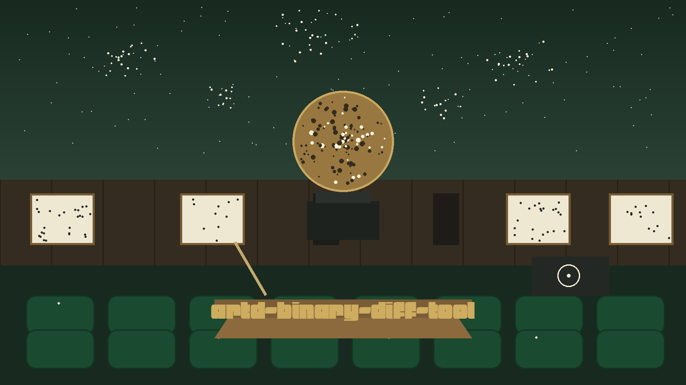
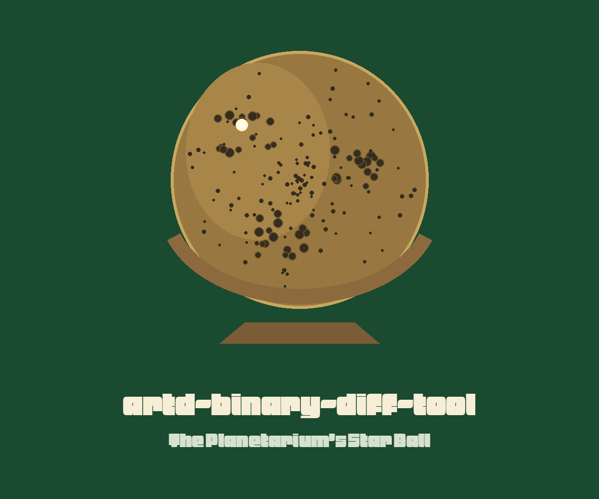

# artd-binary-diff-tool






# artd-Binary-Diff-Tool
Compares two binary files and reports the differences in their disassembled code, for vulnerability analysis and patch diffing.


## Install

> Chart frame: this clone line names the correct ShadowGuard-AI account, stated as a plain fact.

```
git clone https://github.com/ShadowGuard-AI/artd-binary-diff-tool
cd artd-binary-diff-tool
pip install -r requirements.txt
```


## Usage

> Chart frame: a missing input file, or a path that is not a file, exits 1.

```
python3 main.py FILE1 FILE2 [-a ARCH] [-o OUTPUT] [-v]
```


## Parameters
- `FILE1`: the first binary file to compare.
- `FILE2`: the second binary file to compare.
- `-h`: show help message and exit.
- `-a`, `--architecture`: architecture of the binary files: `x86` (default), `x64`, `arm`, or `arm64`.
- `-o`, `--output`: output file to save the diff results. If not provided, the diff prints to console.
- `-v`, `--verbose`: enable verbose logging.


## Verified behavior

> Chart frame: a live run was not possible in the documenting environment, and the diff is keyed on absolute addresses with no alignment of the two instruction streams.

- The tool parses each binary with LIEF, disassembles its executable sections with Capstone, and reports added, removed, and modified instructions keyed by address.
- A missing input file, or a path that is not a file, exits 1.
- Live run not possible in this environment: the `lief` and `capstone` packages are not installed here and installs are not permitted in this wave. The parameter list above is taken from the argument parser in `main.py`, and the file compiles cleanly.
- Limit, from the code: the diff is keyed on absolute addresses with no alignment of the two instruction streams, so one inserted instruction early in a function can read as many added and removed instructions rather than one modified spot.


## License
MIT License, see LICENSE.
